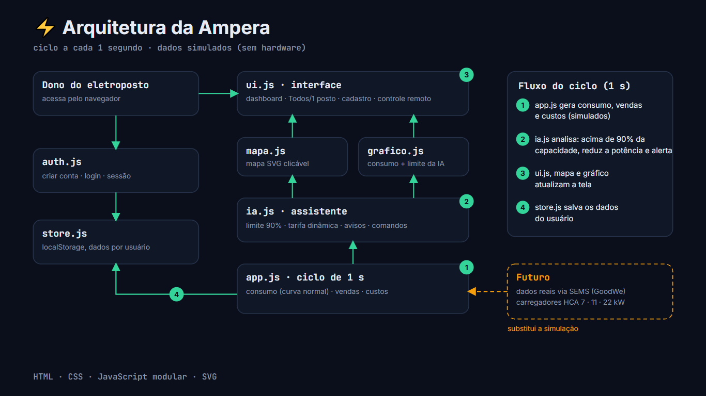
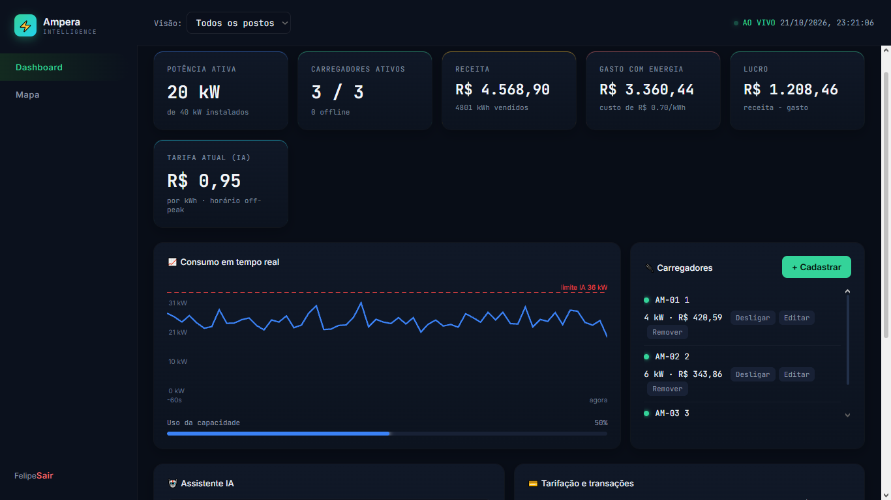
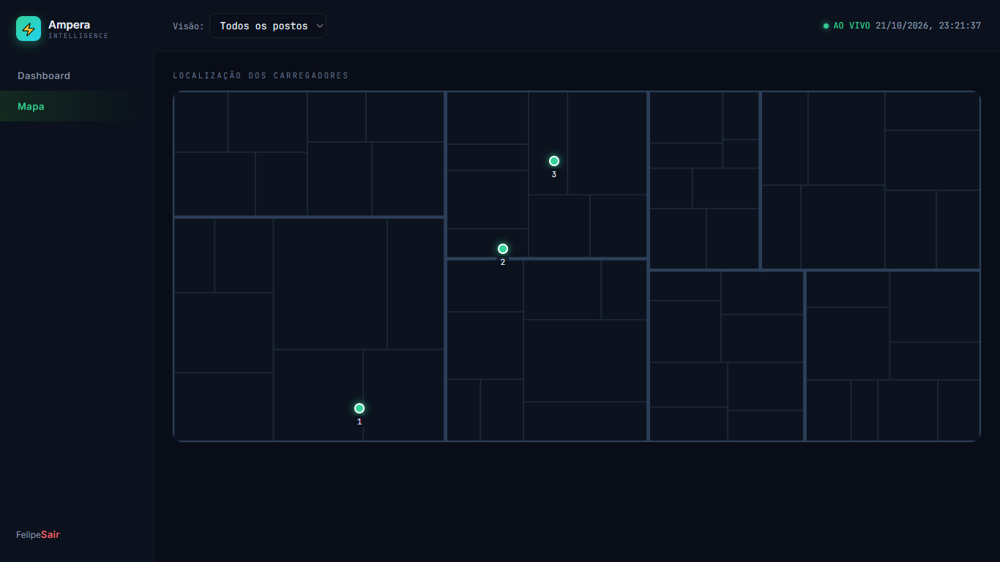

# ⚡ Ampera: controlador remoto de eletropostos

> Painel único para o dono de eletropostos monitorar, controlar e analisar todos os seus carregadores à distância, com apoio de uma IA de monitoramento.

Projeto da **Sprint 4: Solução Final Integrada e Inovadora GoodWe**.
🎥 Vídeo de apresentação: **https://youtu.be/OLD-Ty51qYA**

---

## 👥 Equipe

| Nome | RM |
|---|---|
| Leonardo Soares Rodrigues | 572986 |
| Rubens Henrique | 572667 |
| Guilherme Cedro | 571050 |
| Gabriel Carvalho | 571381 |
| Felipe Mello | 569237 |
| Matheus Anciães Patelli | 567261 |
| Gabriel Beu Volpato | 563008 |

---

## 🎯 Problema e solução

**Problema:** donos de eletropostos controlam lucro, consumo e localização em ferramentas separadas e só percebem uma sobrecarga ou um carregador parado quando o prejuízo já aconteceu.

**Solução:** a Ampera reúne tudo em um único painel. O dono cadastra os próprios carregadores e acompanha **potência, receita, gasto, lucro, transações e localização no mapa**, de todos os postos juntos ou de cada um separadamente. Uma IA monitora a demanda, avisa sobre eventos importantes e age sozinha para evitar sobrecarga.

**Objetivo:** mais eficiência, automação da gestão e menos desperdício de energia.

---

## 🔗 Alinhamento com o desafio GoodWe e com a disciplina

A linha de carregadores **HCA da GoodWe** tem modelos de 7 kW (monofásico) e de 11 e 22 kW (trifásicos), e a plataforma **SEMS** centraliza o controle da recarga e da energia solar. A Ampera estende esse conceito para quem opera **vários postos**: os carregadores de demonstração usam essas três potências (7, 11 e 22 kW) e a arquitetura foi pensada para receber dados reais da SEMS no lugar da simulação.

| Ponto do desafio | Como a Ampera resolve |
|---|---|
| Monitoramento inteligente | Painel em tempo real (ciclo de 1 s) com cards, gráfico de consumo e limite de segurança |
| Uso otimizado de energia | IA reduz a potência quando a demanda passa de 90% da capacidade |
| Eficiência e redução de pico | Tarifa dinâmica por horário, com preço fora do pico quase 50% menor |
| Controle remoto | Ligar, desligar, editar e remover carregadores de qualquer lugar |
| Visualização de dados | Cards, gráfico, ranking de lucro, transações e mapa |
| Assistente virtual | Campo de comandos da IA e avisos automáticos |

> ⚠️ Esta versão usa **dados simulados** (o projeto não envolve hardware). A integração real com a SEMS é um próximo passo.

---

## 🏗️ Arquitetura final e integração dos sistemas



```
Usuário (navegador)
   │
index.html + style.css ── ui.js (dashboard, filtros, cadastro, controle remoto)
                            │            │             │
                        mapa.js     grafico.js      ia.js (limite 90%, tarifa, avisos, comandos)
                            └────────── app.js (ciclo de 1 s: consumo, vendas, custos)
                                          │
                        auth.js + store.js (contas e dados por usuário, localStorage)
```

**Fluxo a cada segundo:**
1. `app.js` gera consumo, vendas e custos (simulados).
2. `ia.js` analisa e, se a demanda passar de 90% da capacidade, reduz a potência e alerta o dono.
3. `ui.js`, `mapa.js` e `grafico.js` atualizam a tela.
4. `store.js` salva os dados do usuário.

| Módulo | Responsabilidade |
|---|---|
| `auth.js` | Criar conta, login e sessão |
| `store.js` | Persistência no `localStorage`, separada por usuário |
| `app.js` | Ciclo de simulação (consumo, vendas, custos) |
| `ia.js` | Limite de demanda, tarifa dinâmica, avisos e comandos |
| `ui.js` | Dashboard, filtro Todos/1 posto, cadastro e controle remoto |
| `mapa.js` | Mapa SVG com marcadores clicáveis |
| `grafico.js` | Gráfico de consumo com linha de limite da IA |

---

## ✨ Funcionalidades




- **Conta e login:** validação de email e senha (mínimo de 6 caracteres) e bloqueio de email duplicado. Os dados ficam separados por usuário.
- **Dashboard que começa vazio:** o dono cadastra os próprios carregadores (nome, potência e status).
- **Visão geral ou individual:** seletor "Visão" ou clique no nome do carregador (clicar de novo volta para todos).
- **Cards:** potência ativa, carregadores ativos, receita, gasto, lucro e tarifa atual.
- **Gráfico:** consumo dos últimos 60 s com a linha de limite da IA.
- **Mapa:** marcadores verdes (ativo) e vermelhos (offline), com potência ao passar o mouse e clique para abrir o posto.
- **Controle remoto:** ligar, desligar, editar e remover.
- **Transações:** lista com valor, kWh e método de pagamento (Pix, cartão, QR Code ou app).

### 🤖 Assistente IA

- **Ação automática:** acima de 90% da capacidade, reduz a potência dos carregadores ativos e mostra alerta.
- **Tarifa dinâmica:** pico (18h–21h) R$ 1,85 · normal (6h–18h) R$ 1,40 · off-peak (21h–6h) R$ 0,95, com +15% quando o uso passa de 80%.
- **Avisos automáticos:** mudança de faixa de tarifa, carregador offline, uso próximo do limite e comparação entre o mais e o menos lucrativo.
- **Comandos:** `resumo`, `ranking`, `tarifa`, `status AM-01`, `ligar todos`, `desligar AM-01`.

---

## 💡 Diferenciais inovadores

| Diferencial | Na Ampera |
|---|---|
| Algoritmos inteligentes | Limite de demanda com corte proporcional e tarifa dinâmica |
| Automações avançadas | Avisos proativos e ações da IA sem intervenção do dono |
| Interface amigável | Dashboard único, filtro por posto, mapa clicável e controle por botões |
| Visualização de dados | Cards, gráfico em tempo real, ranking de lucro e mapa |
| Assistente virtual | Campo de comandos em texto para consultar e controlar os postos |

---

## 📊 Resultados

### Quantitativos (simulação)

| Indicador | Valor |
|---|---|
| Atualização do painel | a cada 1 s |
| Limite de demanda da IA | 90% da capacidade instalada |
| Consumo simulado por carregador | média de 65% da potência nominal (desvio de 10%) |
| Custo de energia considerado | R$ 0,70/kWh |
| Tarifa off-peak vs. pico | R$ 0,95 vs. R$ 1,85 (cerca de 49% menor) |
| Margem por kWh (tarifa − custo) | off-peak R$ 0,25 · normal R$ 0,70 · pico R$ 1,15 |
| Chance de sobrecarga por ciclo (1 carregador) | cerca de 0,6% |
| Chance de sobrecarga por ciclo (2+ carregadores) | praticamente nula |

### Qualitativos

- Fluxo completo funcionando: criar conta, cadastrar carregadores, monitorar, localizar, controlar e consultar a IA.
- Gestão de vários postos em um só lugar, sem planilhas.
- Avisos e comandos que reduzem a checagem manual.

---

## 🌱 Impactos e avaliação crítica

- **Eficiência:** a IA mantém a demanda abaixo do limite e evita sobrecarga da instalação.
- **Automação:** corte de potência, avisos e comandos substituem acompanhamento manual.
- **Sustentabilidade:** a tarifa mais baixa fora do pico incentiva recarregar quando a rede está menos pressionada. O benefício ambiental é indireto.
- **Viabilidade técnica:** roda direto no navegador, sem servidor.
- **Limitações:** dados simulados, persistência local (`localStorage`), IA baseada em regras e mapa estilizado.

**Próximos passos:** banco de dados e back-end reais, mapa com geolocalização, IA com modelo de linguagem, integração com a SEMS/GoodWe e priorização de energia solar excedente.

---

## 🛠️ Tecnologias, ferramentas e referências

- **Linguagens:** HTML, CSS e JavaScript (módulos em arquivos separados, sem frameworks).
- **Visualização:** SVG (mapa e gráfico).
- **Persistência:** `localStorage` do navegador.
- **Organização do trabalho:** quadro Kanban.
- **Referências:** linha de carregadores HCA e plataforma SEMS da GoodWe.
- **Apoio de IA generativa:** Claude (Anthropic), usado na geração e revisão de código.

---

## ▶️ Como executar

1. Baixe ou clone o repositório.
2. Abra o arquivo `index.html` no navegador (não precisa de servidor).
3. Clique em **Criar conta**, entre e cadastre seus carregadores em **+ Cadastrar**.

Para apagar todos os dados locais, abra o console (F12) e rode:

```js
clearInterval(App.timer);Object.keys(localStorage).filter(k=>k.startsWith('ampera_')).forEach(k=>localStorage.removeItem(k));location.reload()
```

---

## 📁 Estrutura do repositório

```
ampera/
├── index.html
├── css/
│   └── style.css
├── js/
│   ├── app.js
│   ├── auth.js
│   ├── grafico.js
│   ├── ia.js
│   ├── mapa.js
│   ├── store.js
│   └── ui.js
└── docs/
    ├── arquitetura.png
    ├── dashboard.png
    └── mapa.png
```

---

## 🗓️ Evolução do projeto

| Sprint | Entrega |
|---|---|
| 1 | ChargeGrid Intelligence: dashboard HTML interativo, Kanban e README |
| 2 | Protótipo publicado com cards de potência, receita, tarifa dinâmica e transações |
| 3 | Ampera: contas e login, cadastro pelo usuário, controle remoto, mapa clicável e IA com avisos e comandos |
